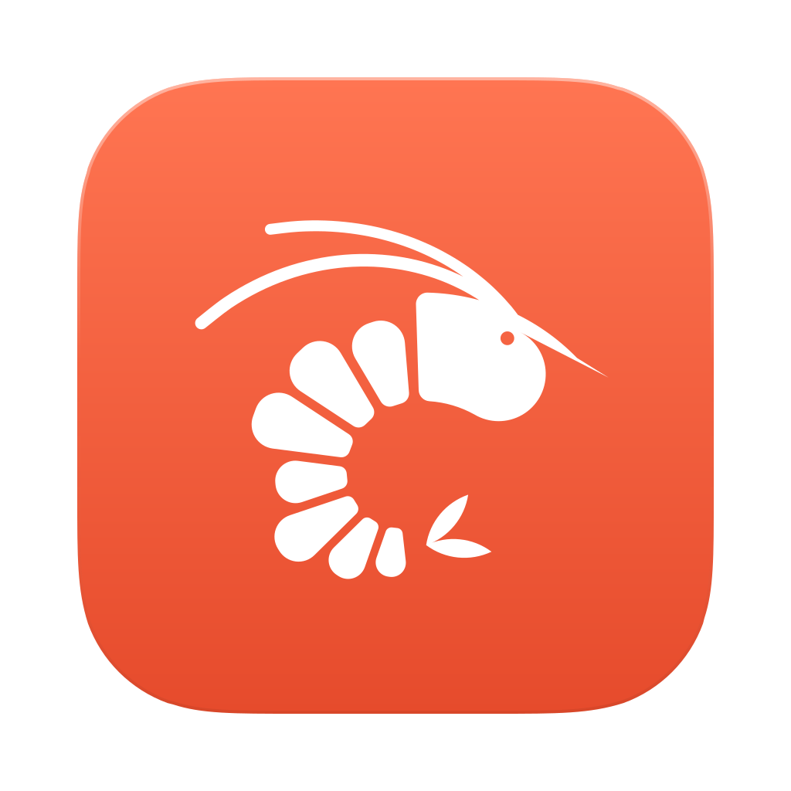
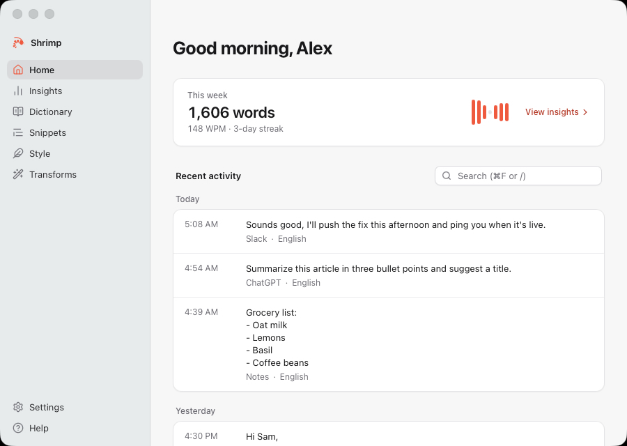
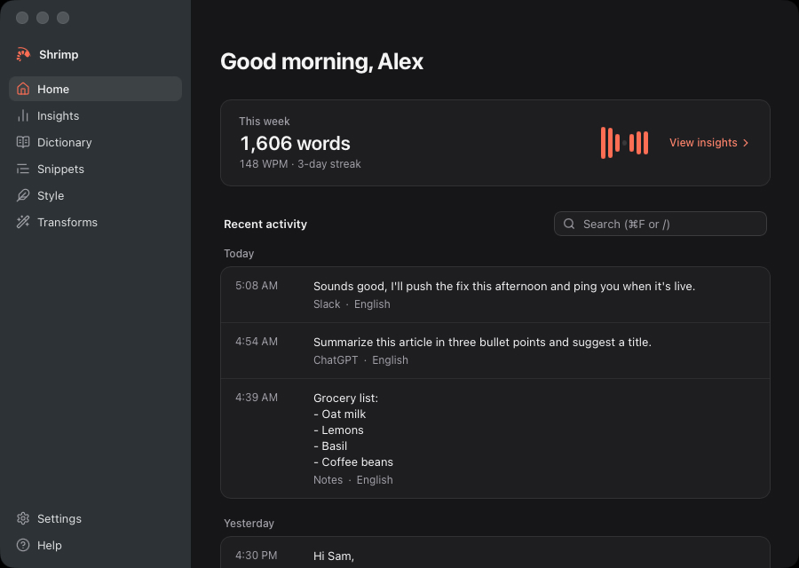

<p align="center">
  
</p>

<h1 align="center">Shrimp</h1>

<p align="center">Speech to text, anywhere. A desktop dictation app for macOS and Windows.</p>

Hold a shortcut, speak, and let go: Shrimp writes what you said at the cursor, in any app.
Speech is transcribed on your computer with [Whisper](https://github.com/ggml-org/whisper.cpp),
and an optional AI model can clean it up, format it and follow spoken commands.

Inspired by [Wispr Flow](https://wisprflow.ai); not affiliated with or endorsed by Wispr.

| Light                                                           | Dark                                                          |
| --------------------------------------------------------------- | ------------------------------------------------------------- |
|  |  |

## Features

- **Dictate anywhere.** Hold fn (Ctrl+Win on Windows) to talk and let go to insert. Press
  fn+Space, or double-tap fn, for hands-free dictation. Text goes in through the clipboard,
  which is restored afterwards.
- **Local transcription.** whisper.cpp runs on the GPU (Metal on Apple Silicon, Vulkan on
  Windows, with the CPU as fallback). Pick a model from tiny to large-v3-turbo; it
  downloads once and then works offline. Many languages, with auto-detect.
- **AI edits (optional).** Removes filler words, applies your self-corrections ("at two,
  actually three"), formats lists, emails and spoken punctuation, and adapts its style to
  the kind of app you're in. Runs on a local Ollama model or a cloud provider with your own
  API key: Anthropic, OpenAI or Groq.
- **Dictionary and snippets.** Teach Shrimp names and terms (it can learn them from your
  corrections), and say a short trigger to insert a longer text or link.
- **Command Mode** (experimental, off by default). Select text, hold fn+Ctrl and say what
  to do with it ("make this friendlier", "translate to Spanish"), or ask a question.
- **Transforms** (off by default). Polish a draft, turn it into a well-structured AI
  prompt, or write your own rewrites, from a shortcut or the Flow Bar.
- **Context awareness.** Names and terms on screen and around the cursor are spelled
  right, and the style follows the app or website.
- **For developers.** Syntax-aware dictation in editors and terminals (camelCase,
  snake_case, CLI commands), file tagging in Cursor and Windsurf chat, and pasting that
  works in terminals and AI coding CLIs.
- **Flow Bar.** A small capsule with a live waveform, notices and a language switch, that
  can sit at any screen edge or hide.
- **History and insights.** Search past dictations, retry or undo an AI edit, and see your
  words per minute, streaks and where you dictate most.
- **And more:** microphone ranking with fallback, whisper mode, muting or pausing media
  while you dictate, launch at login, privacy mode, and an interface in English, German,
  Spanish, Italian and Portuguese.

[docs/PARITY.md](docs/PARITY.md) lists every feature with its acceptance criterion and how
it was verified.

## Install

Download the latest version from [Releases](https://github.com/WHEREISDAN/shrimp/releases/latest).
Shrimp updates itself from there: it checks a minute after launch and every six hours, and
asks before it restarts to install an update.

### macOS

macOS 14.2 or later on Apple Silicon (M1 or newer). Intel Macs aren't supported.

1. Download `Shrimp_<version>_aarch64.dmg`.
2. Open it and drag Shrimp to Applications.
3. Open Shrimp. Setup asks for the permissions below and downloads the speech model
   (about 575 MB).

The app is signed with a Developer ID and notarized by Apple.

### Windows

Windows 10 or 11, x64.

1. Download `Shrimp_<version>_x64-setup.exe` and run it. It installs for your user only and
   doesn't need administrator rights.
2. The installer isn't code-signed, so Microsoft Defender SmartScreen may show "Windows
   protected your PC". Click **More info**, then **Run anyway**.
3. Start Shrimp if the installer didn't, and follow setup. It downloads the speech model
   (about 575 MB).

Updates are still verified: every update must carry a signature from Shrimp's updater key.

## Permissions

On macOS Shrimp needs two permissions, which setup walks you through:

- **Microphone**, to hear you.
- **Accessibility**, to notice the shortcut in any app, paste the text, and read the text
  around the cursor for context awareness.

If pressing fn opens the emoji picker, set System Settings › Keyboard › "Press 🌐 key to"
to Do Nothing. Setup offers to open that setting.

On Windows, Shrimp needs only microphone access: in Settings › Privacy & security ›
Microphone, "Let desktop apps access your microphone" must be on.

## Speech engines and AI providers

| What           | Options                                       | Default             |
| -------------- | --------------------------------------------- | ------------------- |
| Speech to text | Local Whisper, OpenAI, Groq                   | Local Whisper       |
| AI edits       | None, Ollama (local), Anthropic, OpenAI, Groq | Chosen during setup |
| Cleanup level  | None, Light, Medium                           | Light               |

Choose them in Settings. Cloud engines and providers use your own API key, which Shrimp
stores in the operating system's keychain (macOS Keychain or Windows Credential Manager),
never in its settings files, database or logs. If a cloud request fails, Shrimp tells you
why and falls back: to local Whisper for transcription, or to the unedited transcript for
AI edits.

For AI edits without the cloud, install [Ollama](https://ollama.com), pull a model (for
example `ollama pull qwen2.5-coder:7b`) and choose Ollama in Settings.

## Privacy

Shrimp is local by default. With local Whisper and either no AI edits or Ollama, no audio
or text leaves your computer.

When you turn on a cloud option, this is what it receives:

- **A cloud speech engine** (OpenAI, Groq): the recording of each dictation, with your
  dictionary terms (and, with Context awareness on, names read from the screen) as
  spelling hints.
- **A cloud AI provider** (Anthropic, OpenAI, Groq): the transcript, your dictionary terms
  and, with Context awareness on, names and terms read from the screen and the text around
  the cursor. Command Mode and transforms also send the selected text.

Context awareness can be turned off in Settings › Data and privacy; password fields are
never read. **Privacy mode** switches everything to local Whisper and Ollama in one step,
and the Flow Bar and tray icon show a dot while it's on.

Shrimp itself also connects to Hugging Face to download speech models, and to GitHub to
check for updates. It has no accounts, analytics or telemetry. History, recordings,
dictionary and settings stay on your computer; Settings › Data and privacy decides how
long transcripts are kept.

## Building from source

You need [Rust](https://rustup.rs) (the toolchain is pinned in `rust-toolchain.toml`),
Node.js 22 or later and [pnpm](https://pnpm.io) 10, plus the platform tools:

- **macOS:** Xcode with its command line tools, and CMake (`brew install cmake`).
- **Windows:** Visual Studio 2022 Build Tools with "Desktop development with C++", CMake,
  LLVM (with `LIBCLANG_PATH` set) and, for GPU builds, the
  [Vulkan SDK](https://vulkan.lunarg.com).

```sh
pnpm install
pnpm tauri:dev      # run with hot reload
pnpm check          # formatting, lint, type check and all tests
```

macOS asks for permissions again after every rebuild unless the app has a stable
signature; `pnpm app:dev` builds a dev app signed with a local identity that keeps them.
[docs/DEVELOPMENT.md](docs/DEVELOPMENT.md) covers setup, testing and the dev tools,
[docs/ARCHITECTURE.md](docs/ARCHITECTURE.md) how the code fits together, and
[docs/RELEASING.md](docs/RELEASING.md) how releases are built and signed.

## Known limitations

- **Cloud engines and providers are untested live.** The OpenAI, Groq and Anthropic code
  paths are covered by tests, but no successful request against the real services has been
  verified. Local Whisper and Ollama are the tested setups.
- **Windows 11 is untested.** Shrimp was verified on Windows 10. It should work on
  Windows 11, but that hasn't been checked.
- **The Windows installer is unsigned**, so SmartScreen warns on first run (see
  [Install](#windows)).
- **Apple Silicon only** on macOS, and **x64 only** on Windows. There is no Linux version.
- Spoken commands ("new line", "press enter") are English only.

## Status

Shrimp is a personal project, shared in case it's useful to someone else. It's in
maintenance mode: bugs get fixed, but new features are unlikely, and replies to issues and
pull requests may be slow. See [CONTRIBUTING.md](CONTRIBUTING.md) for how to report a bug,
and [SECURITY.md](SECURITY.md) for security problems. Changes are listed in
[CHANGELOG.md](CHANGELOG.md).

## License

[MIT](LICENSE). Shrimp includes open-source software under other licenses, listed in
[THIRD_PARTY_NOTICES.md](THIRD_PARTY_NOTICES.md).
